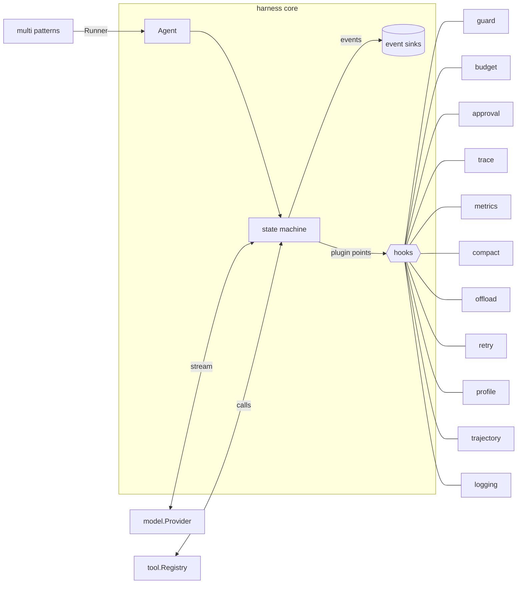
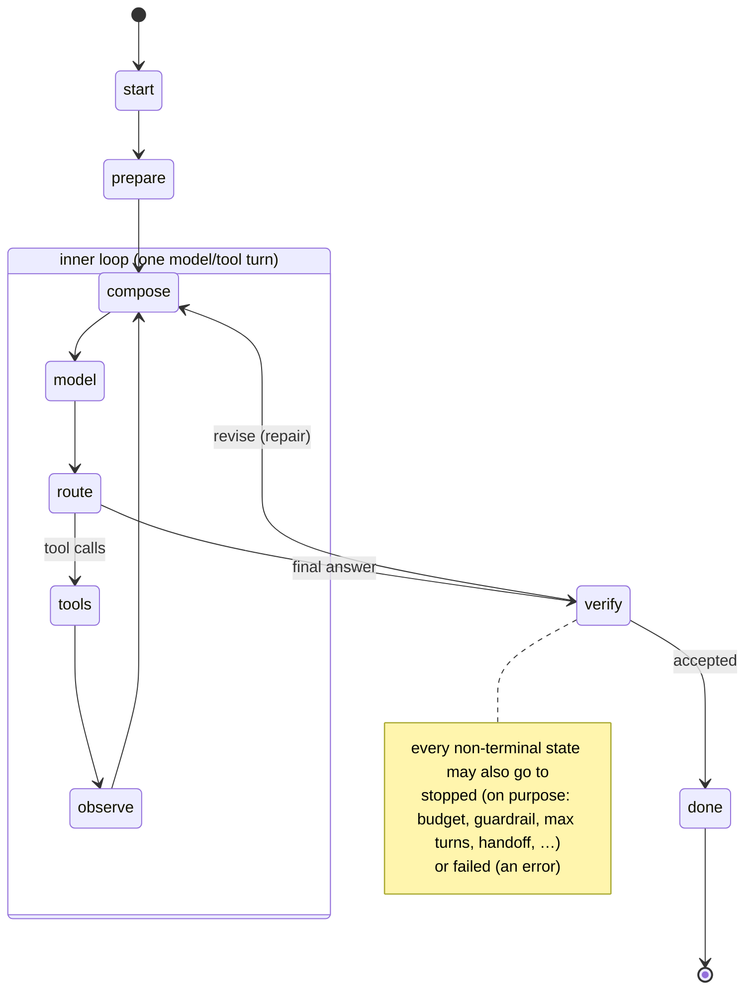

# agent-harness

A small Go library to build agents with: the model/tool loop is an **explicit state machine**, cross-cutting concerns are **hooks** at named plugin points, and **multi-agent patterns** compose from the same pieces. The core has no dependencies outside the standard library.

```
go get github.com/ecociel/agent-harness
```

> Private repository of écociel. No licence has been chosen yet.

- [Why](#why)
- [Architecture](#architecture)
- [The state machine](#the-state-machine)
- [Hook points](#hook-points)
- [Built-in hooks](#built-in-hooks)
- [Multi-agent patterns](#multi-agent-patterns)
- [Try it: the web chat](#try-it-the-web-chat)
- [Using it](#using-it)
- [Fit with corporate-admin](#fit-with-corporate-admin)
- [Sources](#sources)
- [Open questions](#open-questions)

## Why

An agent is a model, a harness and context. The harness decides what context reaches the model, and when. Every harness runs the same loop: call the LLM, run the tools it asks for, feed the observations back, repeat. They differ in what happens at specific moments of that loop, for example:

- summarising before a model call
- retrying the model call
- vetoing a tool call
- offloading a huge tool result
- checking the final answer

([Harrison Chase, *When to build your own agent harness*](docs/sources/video-transcript-summary.md)).

This library makes those moments first-class:

- **States** are explicit and the legal transitions are data (`harness.Transitions()`). An illegal edge is a bug that fails the run, so it can't silently loop. `Result.Path` records every state a run visited.
- **Hooks** are plain values. One hook can implement several point interfaces, so it's easy to see and test what guardrails, budgets, approvals or tracing do.
- **Events**: every transition and every hook invocation is emitted to the event sinks on the context, sub-agents included. Tests, logs and the web chat's diagnostics view all read this one stream.
- **Patterns** (`multi`) are `Runner`s built from agents. They nest, and the same hooks govern every agent inside them.

## Architecture

```
github.com/ecociel/agent-harness
├── harness (root)      Agent, Run, the state machine, hook interfaces, events, Session
├── model               provider-neutral messages, tool calls, usage, streaming events, Provider
├── tool                tool specs (risk, scope), Tool, Registry, Handoff
├── hooks/…             one package per cross-cutting concern (see below)
├── multi               multi-agent patterns (Runners built from Runners)
├── eval                tiny eval runner: tasks × checks (code or LLM judge)
├── provider/fake       deterministic scripted provider for tests and demos
├── provider/openai     OpenAI-compatible Chat Completions (streaming)
├── provider/anthropic  Anthropic Messages API (streaming)
└── examples/webchat    web chat + live hook diagnostics (go run ./examples/webchat)
```

Dependencies only point inwards: `hooks/*`, `multi` and `provider/*` depend on the core; the core depends on nothing but `model` and `tool`.



## The state machine

The **outer loop** is one task (an *episode*: one `Run`, or one `Session.Send`). The **inner loop** is one model/tool turn, repeated until the model answers without asking for tools.



| State | What happens | Plugin points |
|---|---|---|
| `start` | run created, `run.start` event | — |
| `prepare` | admission: input guardrails, budget check, root span | `BeforeRun` |
| `compose` | `MaxTurns` check, build the request (instructions + history + tools) | `BeforeModel` |
| `model` | stream the provider through the middleware chain | `WrapModel`, `OnDelta`, `AfterModel` |
| `route` | tool calls → `tools`; otherwise → `verify` | — |
| `tools` | each call: veto, then execute through middleware | `BeforeTool`, `WrapTool`, `AfterTool` |
| `observe` | turn boundary: loop detection, checkpoints | `AfterTurn` |
| `verify` | output checks: accept, rewrite, revise (repair edge) or block | `CheckOutput` |
| `done` / `stopped` / `failed` | terminal; `run.end` event | `AfterRun` |
| (every edge) | | `OnTransition` |

Stop reasons:

- `completed`
- `max_turns`
- `max_repairs`
- `budget_exhausted`
- `guardrail`
- `policy`
- `loop_detected`
- `handoff`
- `cancelled`
- `failed`

Only `failed` returns a non-nil error from `Run`. Details: [docs/state-machine.md](docs/state-machine.md).

## Hook points

A hook is any value with `Name() string` that implements one or more of these interfaces. The machine finds them by type assertion.

| Point | Interface | Typical use |
|---|---|---|
| `BeforeRun` | `BeforeRunHook` | input guardrail, budget admission, root span |
| `BeforeModel` | `BeforeModelHook` (mutable `*model.Request`) | compaction/summarisation, model profiles, budget pre-flight |
| `WrapModel` | `ModelMiddleware` | retry/fallback, model span, latency metrics |
| `OnDelta` | `DeltaHook` | live streaming UI, streaming guardrails |
| `AfterModel` | `AfterModelHook` | token accounting, budget charge |
| `BeforeTool` | `BeforeToolHook` → `Allow` / `Deny` / `Halt` | tool guardrail, scopes, human approval |
| `WrapTool` | `ToolMiddleware` | tool span, result offloading, timeouts |
| `AfterTool` | `AfterToolHook` | tool metrics, trajectories |
| `AfterTurn` | `AfterTurnHook` | loop detection, checkpoints |
| `CheckOutput` | `OutputHook` → `Accept` / `Revise` / `Block` (+ `Rewrite`) | output guardrail, redaction, verifiers |
| `AfterRun` | `AfterRunHook` | close spans, run metrics, persist trajectory |
| `OnTransition` | `TransitionHook` | state-level tracing |

Middleware nests in slice order: the first hook in `Agent.Hooks` is the outermost layer. A hook can stop the run on purpose by returning `harness.Stop(reason, detail)`. It can explain what it did with `run.Note(hook, "compacted %d messages", n)`; the note shows up on that invocation's event. Details: [docs/hooks.md](docs/hooks.md).

## Built-in hooks

| Package | Points | Concern |
|---|---|---|
| `hooks/guard` | BeforeRun, BeforeTool, CheckOutput | guardrails: deny inputs (secrets), veto tools (allow/deny lists, argument rules, custom checks), revise/block/redact outputs (PII) |
| `hooks/budget` | BeforeRun, BeforeModel, AfterModel, AfterTurn | token consumption and limits: tokens, input/output, cost (price table), model/tool calls, wall time, repeated-call loop detection; hierarchical `Child` budgets for sub-agents |
| `hooks/approval` | BeforeTool | **SPA** (security · policy · approval): caller scopes, a risk threshold, a human or programmatic `Approver`, audit records |
| `hooks/metrics` | WrapModel, AfterModel, AfterTool, AfterRun | monitoring: counters and latency histograms (p50/p95) behind a `Recorder` interface |
| `hooks/trace` | BeforeRun, WrapModel, WrapTool, AfterRun, OnTransition | tracing: OpenTelemetry-shaped spans with `gen_ai.*` attributes, a dependency-free exporter interface (memory, JSONL; bridge to OTel in your app); spans nest across sub-agents |
| `hooks/compact` | BeforeModel | context compaction: summarise old turns (digest or model summariser), keep the last N |
| `hooks/offload` | WrapTool | move oversized tool results to a store, leave a handle plus a `read_offloaded` tool |
| `hooks/retry` | WrapModel | retries with exponential backoff and jitter, fallback provider/model |
| `hooks/profile` | BeforeModel, BeforeTool | per-model profiles: extra instructions, hidden tools, output caps |
| `hooks/trajectory` | BeforeRun, AfterTool, AfterRun | record full runs (JSONL) for evals and replay |
| `hooks/logging` | BeforeRun, BeforeModel, AfterModel, AfterTool, AfterRun, OnTransition | structured `log/slog` lines for runs, model calls, tools and transitions |

## Multi-agent patterns

All patterns are `harness.Runner`s, so they nest: for example a router whose route is a planner–worker system whose workers are agents with sub-agents. Pattern steps are emitted as `pattern` events and traced as `pattern <kind>` spans, and children carry their depth and parent run.

| Pattern | Type | Shape | Source | Doc |
|---|---|---|---|---|
| Sequential | `multi.Sequential` | step → step → step | ecociel/agents `sequential`; Cursor planner→implementer→verifier subagents | [doc](docs/patterns/sequential.md) |
| Parallel (fan-out/fan-in) | `multi.Parallel` | branches in parallel, joined by code or an aggregator | Cursor "parallel agents"; ecociel/agents `parallel`/`concurrent` | [doc](docs/patterns/parallel.md) |
| Best-of-N + judge | `multi.BestOfN` | N candidates, LLM or code judge picks | Cursor "parallel agents, judge" / multiple models; tessmir `critic` | [doc](docs/patterns/best-of-n.md) |
| Router | `multi.Router` | classifier → one route, safe fallback | ecociel/agents `routing`; tessmir `routing` | [doc](docs/patterns/router.md) |
| Subagent (orchestrator–worker) | `multi.Subagent`, `WithSubagents` | lead delegates via a tool; sub-agent gets a fresh context | Cursor subagents (foreground); Dani Zhu "hierarchical delegation"; ecociel/agents `orchestrator` | [doc](docs/patterns/subagent.md) |
| Background subagents | `multi.Background` | `start_<name>` returns a job, `collect` later | Cursor background subagents | [doc](docs/patterns/background.md) |
| Planner / worker / judge | `multi.PlannerWorker` | planner writes tasks (recursive sub-planners), isolated parallel workers, handoff reports, judge decides to continue, fresh start per round | Cursor "Scaling long-running autonomous coding", "Towards self-driving codebases"; ecociel/agents `hierarchical`/`supervisor` | [doc](docs/patterns/planner-worker.md) |
| Evaluator–optimizer | `multi.EvaluatorOptimizer` | generator ⇄ evaluator (APPROVED / REVISE:) | ecociel/agents `critic`; tessmir `verified` | [doc](docs/patterns/evaluator-optimizer.md) |
| Handoff | `multi.Handoff` | peers transfer control (`transfer_to_<peer>`), hop cap | ecociel/agents `handoff`; Dani Zhu "programmed workflows" | [doc](docs/patterns/handoff.md) |
| Shared-state team | `multi.Team`, `multi.Board` | peers claim tasks on a board with optimistic concurrency, add follow-ups | Dani Zhu "shared-state teams"; Cursor "Scaling agents" (locks → optimistic concurrency); ecociel/agents `blackboard` | [doc](docs/patterns/team.md) |
| Debate | `multi.Debate` | independent answers, rounds of cross-reading, judge | ecociel/agents `ensemble`; multi-agent debate literature | [doc](docs/patterns/debate.md) |

The fourth pattern in Dani Zhu's list, *human orchestration* (one person steering several agents, like Cursor's Agents window), isn't a library type. It is what the web chat's pattern switcher and the approval gate give a person, and what `Session` provides per conversation. See [docs/patterns/README.md](docs/patterns/README.md) for how the patterns compare and which source each one came from.

## Try it: the web chat

```sh
go run ./examples/webchat          # scripted demo model, no API key, works offline
open http://localhost:8080
```

One page, styled in the écociel design language with self-hosted fonts and no build step. The **chat** is on the left; the **diagnostics** on the right show, live for every turn:

- **State machine**: the diagram highlights the current state and the edge just taken, with a table of every run, sub-agent runs included (depth, turn, state, stop reason).
- **Hook matrix**: hooks × plugin points. Each cell counts and flashes when it fires: green for ok, blue when the hook acted (with its note as a tooltip), red for deny, stop or error.
- **Budget**: a live token bar, input/output/cached tokens, cost, model and tool calls against the limits, and loop detection.
- **Metrics**: counters and p50/p95 latency histograms.
- **Spans**: the trace of the turn as a timeline, nested across sub-agents.
- **Event stream**: every transition, hook invocation, model reply, tool call and pattern step in JetBrains Mono, filterable.

Pick a pattern at the top of the chat; each pattern runs with the full hook stack. Suggested messages exercise specific hooks:

| Try | What fires |
|---|---|
| `What time is it?` | the full inner loop: tool call, then answer |
| `Compute (17+4)*3` | calculator tool |
| `Search the docs for budget` | **offload** (large tool result moved out of context) |
| `Send an email to Jan` | **approval / SPA**: an approval card appears in the chat (or tick *auto-approve*) |
| `Delete all records` | **guard** vetoes the tool at BeforeTool |
| `My password is hunter2` | **guard** stops the run at BeforeRun (secret in input) |
| `Show my AHV number` | **guard** redacts PII at CheckOutput |
| `flaky: what time is it?` | **retry**: the first model call fails with a 503-style error |
| `loop` | **budget** loop detection stops the run (`loop_detected`) |
| `Tell me something long` (a few times) | **compact** summarises old turns at BeforeModel |

A real model instead of the scripted one:

```sh
HARNESS_PROVIDER=openai    OPENAI_API_KEY=sk-…  [OPENAI_MODEL=gpt-4.1-mini]  go run ./examples/webchat
HARNESS_PROVIDER=openai    OPENAI_BASE_URL=http://localhost:11434/v1 OPENAI_MODEL=llama3.1  go run ./examples/webchat   # Ollama or any OpenAI-compatible server
HARNESS_PROVIDER=anthropic ANTHROPIC_API_KEY=…  [ANTHROPIC_MODEL=claude-sonnet-4-5]  go run ./examples/webchat
```

Flags: `-addr localhost:8080`, `-v` (log every hook invocation to stderr). Sessions live in memory. `reset` forgets yours.

## Using it

```go
weather := tool.Func(tool.Spec{Name: "weather", Description: "Weather for a city."},
    func(ctx context.Context, args json.RawMessage) (string, error) { return `{"temp_c":11}`, nil })

a := &harness.Agent{
    Name:         "assistant",
    Instructions: "Answer briefly.",
    Provider:     openai.FromEnv(),
    Model:        "gpt-4.1-mini",
    Tools:        tool.NewRegistry(weather),
    Hooks: []harness.Hook{
        &guard.Guard{InputDeny: guard.Secrets(), Redact: guard.PII()},
        budget.New(budget.Limits{Tokens: 50_000, RepeatCalls: 3}),
        approval.New(tool.RiskWrite, myApprover),
        &compact.Compactor{MaxTokens: 8_000},
        &retry.Retry{Attempts: 3},
        trace.New(trace.NewTracer(myExporter)),
        metrics.New(registry),
    },
}
res, err := a.Run(ctx, harness.Prompt("Weather in Zurich?"))
// res.Output, res.Stop, res.Path, res.Usage …
```

- Chat: `harness.NewSession(runner).Send(ctx, text)` keeps history across episodes.
- Events: `ctx = harness.WithEvents(ctx, func(e harness.Event) { … })`.
- Patterns: see the `Example…` functions in `multi/example_test.go`. Each pattern has one, and each runs with the fake provider.
- Evals: `eval.Run(ctx, runner, tasks, parallel)` with `eval.Contains`, `eval.StoppedWith` or `eval.Judge`.

Run the checks:

```sh
go vet ./... && go test -race ./...
GOTOOLCHAIN=go1.26.10 golangci-lint run ./...   # optional, if installed
```

## Fit with corporate-admin

The API is shaped so that corporate-admin's hard-coded loop (`cmd/core/agent/turn/worker.go`, `switch agent.Next(limits, turn)`) can later be replaced. That integration is out of scope here. The mapping is in [docs/corporate-admin.md](docs/corporate-admin.md):

- `model.Provider` uses corporate-admin's streaming shape (`Complete(ctx, req) iter.Seq2[Event, error]`).
- `CallModel`+compact → `compose`/`BeforeModel` + `model`.
- `StartTool`/`AskApproval`/`RunTool` → `tools` with `BeforeTool` (approval) and `WrapTool`.
- `RecordResult` → `AfterTool`/`observe`.
- `Finish` → `verify`/`done`.
- `Refusal` → `StopGuardrail`/`StopPolicy`.
- `Wait` (durable suspension) is the one gap; see open questions.

## Sources

- **Harrison Chase (LangChain), "When to Build Your Own Agent Harness"** (Sequoia, https://youtu.be/HI2q3ci3Iuc). This is the primary source for the loop and the plugin points. Summary: [docs/sources/video-transcript-summary.md](docs/sources/video-transcript-summary.md).
- **Cursor**:
  - [Scaling long-running autonomous coding](https://cursor.com/blog/scaling-agents)
  - [Towards self-driving codebases](https://cursor.com/blog/self-driving-codebases)
  - [Best practices for coding with agents](https://cursor.com/blog/agent-best-practices)
  - [Subagents docs](https://cursor.com/docs/subagents)
- **X post on multi-agent architectures.** The brief asked for a post by "Lauren Tun". No such post was found (see [open questions](#open-questions)). The closest match is Dani Zhu, [*4 main multi-agent orchestration patterns*](https://x.com/danizhu/status/2109166908591268315) (11 Oct 2026): programmed workflows, hierarchical delegation, shared-state teams and human orchestration.
- **ecociel/agents**: the pattern catalogue and `production-agent-components.md` (inner and outer loop, explicit state machine), plus `budget`, `trace`, `checkpoint` and `eval`.
- **ecociel/tessmir** and **tessmir-old**: the callback set of the `agentloop` machine (trace, budget, checkpoint, redact, prompt-compose, tool authz/before/after, human gate), the stop reasons, and the pattern state-machine docs.

## Open questions

1. **"SPA".** The brief used the term without defining it. It is implemented as **S**ecurity · **P**olicy · **A**pproval (`hooks/approval`: scopes, risk threshold, a human gate and an audit trail), shown interactively in the web chat. Other readings, all already covered: *spans* (`hooks/trace`), *spend* (`hooks/budget`), *single-page app* (the web chat is one). Please confirm what was meant.
2. **The "Lauren Tun" X post** couldn't be found. The X account @Lauren_tun is unrelated, and searches for the name together with Cursor and multi-agent found nothing. The patterns come from Cursor's own blog and docs plus the closest matching post (Dani Zhu). If you have the link, the pattern list can be checked against it.
3. **Durable suspension.** corporate-admin's `Wait` step and tessmir's `suspend` exit park a run across processes, for example while an approval is pending. Here approval blocks in-process (with a timeout). Adding a `suspended` state with checkpoint/resume is the natural next step for the corporate-admin integration.
4. **OpenTelemetry bridge.** The core stays dependency-free, so an OTel exporter (`trace.Exporter` → `go.opentelemetry.io/otel`) belongs in the app or in a separate module.
5. **Licence.** None was added, as instructed.
