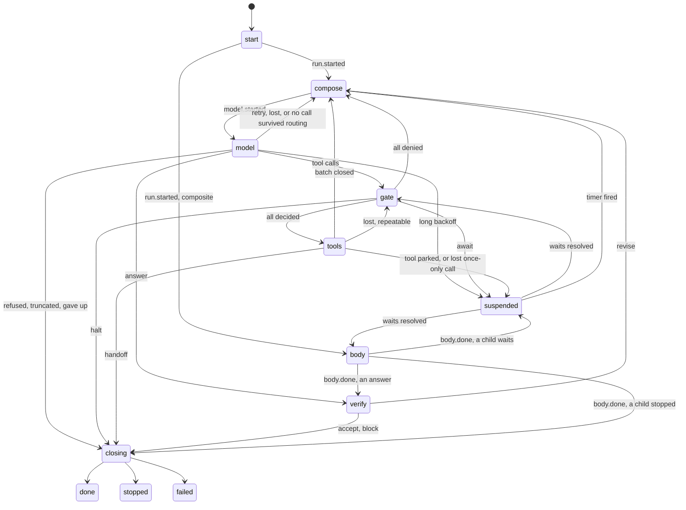

# Durable core

**Status: design agreed, 2026-10-30. Units 1, 2 and 3 of the plan are done on the `durable-core` branch.** Patterns and hooks that aren't ported yet sit in `_unported/`, which Go ignores. The earlier evidence comes from the working sketch at `.audit/durable-core/spike-sketch/`.

## Problem

The package must own the mechanism of a production agent: the state machine, ordering, crash semantics. The software that uses it owns the details: which database, which summariser, which price table, which exporter, which PII rules.

Today a run lives in a Go struct on one goroutine, and hooks write that struct directly. Nothing can say what was true at a crash. Durability can't be added as a hook, because what it needs are ordering guarantees inside the loop: intent before effect, usage before anything reads it, redaction before anything stores. So the core has to change, not just gain a hook.

## The design in four sentences

The truth about a run is an append-only journal of events. `Fold` computes a `Run` from the journal, and a private pure `next` picks the next step from that `Run`. A thin shell performs the step, records what happened, and loops. `Run` is idempotent on `RunID`, so starting, resuming, signalling and retrying are one call.

## Usage

No store. The same loop runs over a slice.

```go
run, err := agent.Run(ctx, harness.Prompt("Weather in Zurich?"))
```

Durable. The consumer implements two methods. A unique index on `(run_id, seq)` is the whole contract.

```go
type Journal interface {
	Append(ctx context.Context, runID string, evs []Event) error // all or nothing, ErrConflict if a position is taken
	Load(ctx context.Context, runID string) ([]Event, error)
}

// Optional, for trees with long-lived parents. Without it, the same answer comes from Load.
type LineageReader interface {
	Lineage(ctx context.Context, runID string) (Lineage, error)
}

agent := &harness.Agent{Name: "refunds", Provider: p, Tools: tools, Journal: pgJournal{db},
	Hooks: []harness.Hook{approvals{}, redactAHV{}}}

in := harness.Prompt("Refund order 4711")
in.RunID = "refund-4711"
run, err := agent.Run(ctx, in) // redelivery is safe: the same call converges on the same run
```

A suspended approval, resumed from an HTTP handler in another process. The process builds the same `Agent` and shares nothing else.

```go
func (a approvals) BeforeTool(_ context.Context, _ harness.Run, c harness.Call) harness.Decision {
	if c.Spec.Risk < tool.RiskWrite {
		return harness.Allow()
	}
	s, ok := c.Signal("approval")
	switch {
	case !ok || s.Expired:
		return harness.Await(harness.Wait{Kind: "approval", Detail: "run " + c.Name, TTL: a.ttl})
	case s.Value != "yes":
		return harness.Deny("declined by " + s.By)
	}
	return harness.Allow()
}

// elsewhere
run, err := agent.Run(ctx, harness.Resume(runID, harness.Signal{Wait: waitID, Value: "yes", By: user}))
```

A complete redaction hook.

```go
func (redactAHV) Name() string { return "redact-ahv" }
func (redactAHV) Redact(_ context.Context, _ harness.Kind, s string) (string, error) {
	return ahv.ReplaceAllString(s, "[AHV]"), nil
}
```

A tool declares what a repeat means. The zero value is the safe one.

```go
refund := tool.Func(tool.Spec{Name: "refund", Risk: tool.RiskDangerous, Effect: tool.EffectIdempotent, Timeout: 30 * time.Second},
	func(ctx context.Context, args json.RawMessage) (string, error) {
		return psp.Refund(ctx, args, tool.IdempotencyKey(ctx))
	})
```

## Shape

### Data

| Type | Role |
|---|---|
| `Event` | The only record. The journal stores it, sinks receive it, `Fold` reads it. |
| `Journal` | `Append` and `Load`. The unique index is both the ownership fence and the outbox. |
| `Run` | The fold. No mutex, no `Agent` pointer, no scratch map. Hooks get it by value, as a shallow copy (see Agreed decisions not yet built). It replaces `Result`. |
| `Composite` | A run whose work is to run others. Every pattern is one. It has a body and no model. |
| `Input` | `RunID`, `Messages`, `Signals`, `Cancel`. |
| `Pin` | Recorded at start: instructions, model, limits, schema, tool fingerprints. Wiring stays live. |
| `Wait`, `Signal` | What a suspended run needs, and the answer. |
| `Edit` | The only durable way to change history. It stamps `Source` for provenance. |

### Load-bearing decisions

1. **One write path.** `record` runs in a fixed order: redact, check the edge, append, adopt, emit. `apply` is the only code that changes a `Run`. Live execution and recovery use the same `apply`.
2. **Hooks return values.** The shell records the value. No hook runs on the replay path, so a decision can't come out differently later. A hook runs at least once, so anything it does outside the run must tolerate a repeat.
3. **Intent before effect**, for tools and for paid calls. On resume, an open `model` state or a `started` call can only mean the outcome was lost.
4. **Redaction is the innermost ring.** It wraps the provider and the tool call directly, inside `WrapModel` and `WrapTool`, and `record` is the backstop. With a redactor configured, no hook sees raw data, and a redactor error fails closed. With none configured, the ring does nothing. A redactor that can't filter a stream buffers the reply, so live streaming is lost while it is attached.
5. **The index is the fence.** A worker taking a run appends `run.claimed`, and the previous worker's next append fails with `ErrFenced`. There is no lease code and no heartbeat in the core. Candidate 1 had a heartbeat, and it produced a real data race.
6. **Contexts stop workers, not runs.** Cancelling a context acts like a crash and returns `ErrDrained`. Only `Input.Cancel` ends a durable run.
7. **`Event.Wake`** is on the last event of every append. Projected into a row inside the `Append` transaction, it gives one sweep query for crashed workers, due timers and drained runs, with no third `Journal` method.
8. **Every tool call gets exactly one result.** `closeBatch` answers each call in call order, whatever ended the batch. A call that never ran gets a synthetic `{"skipped":true}` result. An unanswered tool call can't reach history.
9. **Child identity is derived.** A sub-agent's run ID is the parent's idempotency key. A parallel branch is `<parent>/<index>`, taken from the loop that starts the goroutine, never from the scheduler.
10. **A composite run spends nothing.** It writes no `model.*` or `tool.*` event, and `Fold` gives it no spend, so a sum over a tree's runs needs no exceptions. What its children spent reaches its caller through `Run.Spent`, as a report on `body.done`.
11. **Cancel has two paths, because a worker and its absence need different things.** A running branch reads its ancestors after recording each intent, so it needs no child ID. A parked or crashed branch has no worker to read anything, so its parent ends it through the child's own `Runner`, the way a signal travels.
12. **The ancestor check has an optional fast path.** Loading a parent's journal on every step makes each child step cost the parent's whole history. A `Journal` may also implement `LineageReader`, one projected row per run. It stays optional so that `Journal` stays two methods, and a store without it is slower, not wrong. A cache was rejected, because it would let a child pay after a cancel it could have seen.
13. **An assistant message goes back in the order it was produced, built from the history.** Current Anthropic models think by default, and a signature covers everything before its block. `Opaque` keeps the thinking blocks and the shape of the reply, not its text. So a replay can't undo a hook or a redactor, and a message that no longer fits its shape goes back without thinking. Thinking text in `Opaque` is redacted like any text, as decided: a redactor that changes it invalidates the signature, and the recovery below handles that.
14. **A refused signature costs one more request, not the run.** A history edit such as compaction invalidates later signatures, and the same body fails forever. The Anthropic adapter sends that call again with all thinking stripped, which needs no beta header and works on every platform. It's a recovery, not a steady state: the model loses that reasoning, and each later turn pays one refused request.

### State machine



Every live state also takes `run.claimed` and `run.stopping`. The table in `state.go` is data, keyed by the event that takes the edge. `Fold` checks it on every replay, so a journal can't hold a forbidden walk.

A composite has `body.done` and no `body.started`. An intent event guards an effect that must not repeat, and a body has none of its own: its children record theirs. A crash anywhere in a body leaves the state where it was, and the next worker runs it again.

`prepare`, `route` and `observe` go away. Admission happens at each claim, routing is a pure function, and the turn boundary is `compose`. `gate` and `closing` are new, because "all calls decided" and "outcome known but `AfterRun` not finished" are real crash points.

Routing on the finish reason is one pure function:

| Finish | Tool calls | Result |
|---|---|---|
| `stop`, `tool_calls` | yes | `gate` |
| `stop` | no | `verify` |
| `length` | yes | calls answered unexecuted, model told, `compose` |
| `length` | no | `closing`, `StopTruncated` |
| `content_filter`, `refusal` | any | `closing`, `StopRefused` |

### Hook points

There are 12, the same count as today, and all of them return values.

```go
Redact(ctx, kind Kind, text string) (string, error)
BeforeRun(ctx, r Run) error
Context(ctx, r Run) (Edit, error)                                       // durable history edit, recorded
BeforeModel(ctx, r Run, req *model.Request) error                       // per-call edit, not recorded
WrapModel(r Run, next model.Provider) model.Provider
AfterModel(ctx, r Run, resp model.Response) (model.Response, error)     // what it returns is recorded
Recover(ctx, r Run, f Failure) Recovery                                 // retry, fallback, durable backoff, give up
BeforeTool(ctx, r Run, c Call) Decision                                 // allow, deny, halt, await
WrapTool(r Run, next ToolFunc) ToolFunc
AfterTool(ctx, r Run, c Call, content string) (string, error)           // what it returns is recorded
CheckOutput(ctx, r Run, output string) Verdict                          // accept, revise, block, rewrite
AfterRun(ctx, r Run)                                                    // at least once
```

`OnDelta`, `AfterTurn` and `OnTransition` go away. Streaming guardrails live in `WrapModel`. Metrics and tracing read events, which are now complete.

A composite run has no model and no tools, so only `Redact`, `BeforeRun`, `CheckOutput` and `AfterRun` reach it. `CheckOutput` stays a real guardrail: it can block or rewrite the answer. A revise ends the run with `StopMaxRepairs`, because no model is there to try again.

## Concern matrix

| # | Concern | The package owns | The consumer supplies |
|---|---|---|---|
| 1 | Durability | `Journal`, `Fold`, idempotent `Run`, record before acting | The store, two methods |
| 2 | Side-effect safety | `tool.started` before the effect, `IdempotencyKey`, `Effect`, `WaitUnknownOutcome` | Each tool's `Effect`, a ledger if wanted |
| 3 | Suspension | `suspended`, `Wait`, `Signal`, `Await`, expiry, re-decide on resolve | Approval UI, who may approve, a sweeper |
| 4 | Context, compaction | `Context` returns a recorded `Edit`, `BeforeModel` edits are per call | Summariser, retrieval, token counting |
| 5 | Memory | Load in `Context` with `Edit.Source`, save in `AfterRun` | Memory store and policy |
| 6 | Token spend | Usage in `model.done`, folded once, `LostCalls` as the honest bound. A tree is a plain sum over its runs | Price table, limits, tenant totals inside `Append` |
| 7 | Tracing | Stable `RunID`, `RootRun`, `ParentRun`, `Seq`. Span IDs hash run and step | Exporter, as a sink |
| 8 | Metrics | The event vocabulary | Backend, as a sink |
| 9 | Guardrails | `BeforeRun`, `BeforeTool`, `AfterModel`, `AfterTool`, `CheckOutput`, `WrapModel` for streams | Rules |
| 10 | Redaction | The ring, the `record` backstop, inheritance by child runs, fail closed | Patterns |
| 11 | Permissions | `Risk`, `Scope`, `Effect`, per-turn `Offered` enforced in the fold | Policy, principal |
| 12 | Retry, fallback | `model.Error` classes, `Recover`, recorded decisions, durable backoff | Policy, classification in adapters |
| 13 | Timeouts, shutdown | `Spec.Timeout`, `WithDrain`, `ErrDrained`, tree-wide `Input.Cancel`, the fence | Deadlines, when to call `Run` |
| 14 | Tool execution | Batch order, adjacent reads in parallel, single writer, `closeBatch` | Tools |
| 15 | Multi-agent | `Composite`, derived child IDs, finished children answer from their journals, wait forwarding | Which patterns, `ChildTool` on a tool that starts runs |
| 16 | Sessions | A run is workflow state. `Session{ID, Turn, History}` is conversation only | Where to save those fields |
| 17 | Evaluation | `Fold` needs no provider, tool or hook. A what-if copies an event prefix | Eval suites |
| 18 | Versioning | `Pin`, `Drift`, calls to a changed tool denied and replanned | Migrations in `Journal.Load` |
| 19 | Operability | `Fold` exposes `State`, `Waits`, `Updated`, `Claims`, `Class`. `Wake` for sweeps | Dashboards, the sweep |

## Crash behaviour

| Worker dies around | Just before the append | Just after the append |
|---|---|---|
| `run.started` | No run exists, the caller retries | Claim, then `compose` |
| `model.started` | No call happened, `compose` repeats | `model.lost`, new attempt, may have been billed |
| `model.done` | Billed and lost, same as the cell above | Usage folded once, routing continues |
| `tool.gated` | Hooks rerun | The claim voids `allow`, hooks rerun, `await` waits stand |
| `tool.started` | No effect, decisions redone | `tool.lost`: `EffectOnce` suspends on an unknown outcome. Others return to `gate`, so `BeforeTool` hooks and approvals run again, then the tool reruns under the same key |
| `tool.done` | Effect happened, result lost, same as the cell above | The result stands |
| `wait.resolved` | The sender retries | A duplicate is ignored |
| `body.done` | The body reruns, and finished children answer from their journals | The outcome stands, and the body doesn't run again |
| `run.stopping` on a cancel | The sender retries, and any process may | A repeat finishes the walk below, then `run.ended` |
| `run.ended` | `AfterRun` reruns, and so does a cancel's walk below | `Run` returns the stored outcome |

Spend is a bound, not exact: `ModelCalls <= billed <= ModelCalls + LostCalls`. No client can know whether a call that died in flight was billed. A cancel that cuts a call off counts it as lost too. A branch that stops at the ancestor check, after its intent and before the call, also counts one. That is the check's price: it widens the bound by one and can't make it false.

## Evidence

Measured on the working tree at the end of unit 3:

- `go build ./...`, `go vet ./...` and `gofmt -l .` are clean at the root and in `journal/postgres`.
- `go test -race -count=10 -timeout 560s ./...` exits 0 at the root, across all 11 tested packages. `multi` took 154s.
- The six sweeps run 764 cases, counted from their logs. That is fewer than the spike's 900 because a two-branch `Parallel` now appends 24 times, not 30, and they still kill every append of every run in a tree, before and after the write, with and without a second crash on restart. They cover `Parallel`, `Sequential`, an aggregator, an approval inside a sub-agent, a background job, and a lead over a `Parallel` over a `Sequential` with an approval. Every case asserts that each once-only tool ran exactly once, that the output equals the uncrashed run, and that `ModelCalls <= billed <= ModelCalls + LostCalls` holds for a plain sum over the tree. Pattern roots also assert that `Run.Spent` equals that sum.
- `TestCrashSweepOfACancel` runs 96 more cases, killing a cancel at every append of every run it touches. Every run must end cancelled, with nothing paid for and nothing run, once the sender retries.
- `TestNoPatternWritesAModelEvent` covers five tree shapes, and a plain sum there equals what the provider billed. `TestCancelStopsABranchThatIsAlreadyRunning`, its agent-root twin, and the tests for a child no walk can find assert that a cancelled branch pays for no further call and starts no further tool.
- The mutation script reports 118 of 118 caught by a named test, with no survivor and no mutant that failed to build. 54 of them are for the mechanisms of unit 3 and 5 of those ran on real SQL. The first full run gave 111 of 118. Three survivors were real: two tests hid a swallowed error behind a crash that also stopped the next write, and removing the scripted lead had left one agent edge untested. Three named the wrong test, and one did not compile. The tests changed and the mutants did not get easier.

Review found two defects that no test or mutant had caught. A cancel that fenced a model call in flight left it out of `LostCalls`, which broke the billing bound (`billed 1 outside [0, 0]`, now `TestACallInFlightAtACancelCountsAgainstTheBound`). A call in flight also closed as `{"skipped":true}`, which told the next turn that a payment that ran had not.

Measured on real PostgreSQL 17.6 through `journal/postgres`, at the end of unit 3:

- `go test -race -count=3 ./...` exits 0. With `-v`, all 8 tests and all 14 conformance checks ran, and none skipped. The checks include crash sweeps through one agent and through `Parallel`, two workers racing one run, concurrent writers racing every position, and a cancel reaching a running child and a parked branch. These sweeps are a smaller set than the 764 cases above.
- Both adapters ran through the machine against a scripted server: rate limits, `Retry-After`, long waits that park, cut streams, auth failures, full contexts, drains and redaction. The Anthropic adapter's history was a byte-identical prefix from request to request across a crash, the check the API docs give. Of 37 mutants in unit 4, 36 were caught and one changes no behaviour.
- `journaltest` refuses all 11 deliberately broken journals, each at the check named for its bug, and all 6 wrong `Lineage` projections.
- One ancestor read, averaged over 50, on a run of 2 KB events: `Load` takes 0.9 ms at 100 events, 6.2 ms at 1,000 and 54.7 ms at 10,000. `Lineage` takes 0.24 to 0.29 ms at all three.

Measured on real PostgreSQL at unit 1, and not rerun: all 7 mutants of the Postgres journal itself are caught.

Reported by the spike in `.audit/durable-core/spike-report.md`, and not rerun:

- Nine defects were found, six of them on the untouched base. The worst left a child suspended forever. All nine are fixed and have tests.
- `go test -race -count=10` failed 6 times in 10 on its first run, which is how the mutual fence below was found. A single pass would have missed it.

**Not verified.** No real process kill, and no call to a real provider. The adapters run through the ring against a scripted HTTP server that follows the published API. The crash sweeps kill the journal, not the process, and the cancel tests run their workers in one process. A cancel recorded after a worker's check and before its provider call starts is not tested as an interleaving: by reading the code, it is the same as a call already in flight, which counts as lost. Seven of eleven patterns and eight of eleven hooks are not ported, and `Handoff` and `Team` are expected to be the hard ones (a guess).

## Synthesis decision

Three working sketches competed. Scores are from one separate judge reading the code. All three sketches and the judge ran on Claude models, so there was no second model family, and corporate-admin fit was one of six scoring criteria, chosen by the design's author:

| Candidate | Score (of 30) | Why it lost or won |
|---|---|---|
| Event-sourced decider | 24 | **Base.** The machine is the truth, and the shape stops hooks skipping redaction, ordering and fencing. Matches corporate-admin's `agent.Next` |
| Replayed effects | 21 | Best multi-agent story. But custom `Runner`s must be deterministic, hooks that don't rerun silently break after resume, and any change to step order diverges suspended runs |
| Snapshot machine | 20 | Simplest mental model. But it rewrites the whole body at every commit, hooks can write any snapshot field, and its heartbeat had a real data race |

Grafted into the base: the redaction ring (candidates 1 and 3), `AfterModel` and `AfterTool` as value-returning seams, the wake time (candidate 1), and stable positional fork identity (candidate 3).

## Design changes the spike forced

1. **A pattern needs a durable row.** The base claimed a pattern could stay stateless and resume by rerunning. That failed with `no such run: root/1`, because an unstarted branch has no recorded input. Signals also could not reach the right branch. The sketch made a pattern a lead agent with a scripted model, which wrote `model.*` events for calls nobody paid for and made consumers skip them. Unit 3 replaced that with `Composite`, one state and one event. The skips are gone.
2. **`ErrFenced` no longer means someone else owns the run.** In a tree, each run has its own fence, so two live workers can stop each other. This is safe, but it means a sweep is required for trees. Unit 3 does not change this. A cancel fences runs one at a time and adds no owner for the tree, and `TestTwoLiveWorkersCanFenceEachOtherAndTheNextRunConverges` still forces the stall.

## Agreed decisions not yet built

- **A test check guards the `Run` copy.** `view()` clones the `Messages` slice but not each message's `ToolCalls`, so a hook can change shared state despite having no setters. A deep copy per hook costs O(history). Test helpers fail if a hook changed its `Run`, and production stays unchecked, so a careless hook that slips past tests can still corrupt a live run.

## Known limits

Each of these was left on purpose.

- **Two live workers can still fence each other.** See above. It is safe, and the tree waits at most one `Lease` for a sweep.
- **A child with no worker needs a way down.** A parked or crashed child is ended through a pattern's parts or a `ChildTool`. A child started by a plain tool stays parked, because only the tool holds its `Runner`. That is safe: its parent no longer holds the wait, and the ancestor check stops it if a worker ever takes it (`TestCancelStopsAChildNoWalkCanFindBeforeItsNextModelCall` proves the running case).
- **A cancel can lose a race with a live worker.** `Input.Cancel` is an append, so it returns `ErrFenced` and writes nothing, and the sender sends it again (`TestACancelThatLosesARaceSaysSoAndARetryLands`).
- **Cancelling a finished run does nothing, so a background job can outlive its lead.** Cancel the job by its own ID (`TestACancelAfterTheLeadFinishedDoesNotReachItsJob`).
- **Only a cancel reaches down.** A `Parallel` that fails on one branch leaves a parked sibling parked, as it did before. Safe, by reading the code.
- **A `Context` hook runs before the ancestor check.** A summariser that calls a model from that hook can pay once more after a cancel. That call is the hook's own, and the journal can't see it. By reading the code.
- **`Run.Spent` is a report.** A composite's is what its body last said, and a run ended from outside reports nothing further. An agent's leaves out children its tools started. For a tree, sum the runs.
- **A sweep can land between two steps of a `Sequential`.** Nothing is working in that instant, so a root past its `Lease` is due and the tree is taken over. By reading the code, that is the zombie case, and it repeats nothing.
- **Ancestors are read through the parent's journal.** A child with its own `Journal` still sees its parent. A grandparent in a third journal is out of its sight. By reading the code.
- **No adapter has met a real API.** The wire shapes come from the published docs, and `TestLiveToolLoop` is there to check them. The strings `prompt is too long` and `exceed context limit` come from memory, not the docs. If they're wrong, a full context reads as `invalid`, so the run fails instead of compacting. A `413` is classified without them.
- **Compaction needs a plan in unit 5.** Keep-tail compaction leaves retained turns with stale signatures, so every later Anthropic call pays one refused request until those turns are gone. The docs recommend summarising everything, or stripping the retained turns' thinking. A per-turn reminder that a `Context` hook adds and later removes breaks the same check.
- **A retry after a cut stream repeats text to sinks.** Deltas already streamed stay streamed, so a live UI shows the partial reply and then the whole one. By reading the code.
- **The Anthropic adapter stays on API version `2023-06-01`, with a default `max_tokens` of 4096.** Thinking counts against that limit, so set `MaxTokens` on current models. Version `2026-10-21` refuses `temperature` on every model, so moving to it is a separate change.
- **A wrapper can hide the fast path.** A journal wrapped for tracing or fault injection has no `Lineage` unless the wrapper forwards it. Runs then fall back to `Load`, which is correct and slower. Nothing reports the fallback.

## Tradeoffs accepted

- We accept 336 exported names against 204, and 2,240 code lines against 974 in the root package, in exchange for covering all 19 concerns. Unit 3 added 25 names, counted by hand, and 173 lines, and took 35 lines out of the four ported `multi` files.
- We accept a journal write per step, about 15 appends for a 2-turn run with 4 tools, in exchange for a crash point at every step.
- We accept that the model and tools work from redacted text, in exchange for a guarantee with no exceptions. A tool that needs the real value detokenises in `WrapTool`.
- We accept at-least-once hooks in exchange for one recovery rule.
- We accept no lease in the core. A sweep that fires early costs a needless unknown-outcome wait, never a repeated effect.
- We accept that a nested run reads each ancestor once per model call and tool start, in exchange for a cancel that needs no child ID. Measured on a two-branch `Parallel` with one tool each and a plain `Journal`: 24 appends, 9 loads, 6 of them for this check. With `LineageReader` those 6 become one-row reads. Depth still multiplies them, and a root reads nothing extra.
- We accept that a root's `Wake` is a floor and not a sign of life. A tree is due at the latest of its root's `Wake` and the `Wake` of whatever below it is working. A pattern only waits, so its `Lease` says how soon to look and need not outlast its slowest branch. A nested pattern has no `Wake`, so its lease can't hide a crash below it.
- We accept that thinking text is stored in the journal, redacted, in exchange for replaying it after a crash. With the default `display: "omitted"` that text is empty and only the signature is kept.
- We accept a flat `Event` struct, in exchange for one vocabulary and no decode registry.

## Settled questions

1. **The model and tools work from redacted text only.** A resume must reproduce what the model saw, so raw text lives nowhere a run reads.
2. **The break is total.** `Result` disappears, every hook signature changes, and `Run` is no longer a pointer. There is no compatibility layer.
3. **corporate-admin is designed for and adapted later.** `Journal` stays generic. The mapping from its turn log looks one-to-one on paper, and it stays unproven until that integration.

## Implementation plan

Each unit lands on its own and ends in a check. Unit 2 ran first, because the suite in unit 1 needs the `Journal` type.

| # | Unit | Done when |
|---|---|---|
| 1 | Done. Journal conformance suite, plus a real Postgres journal in a separate module | Crash sweeps pass against a real database, and the sweep query runs as SQL |
| 2 | Done. Land root, `model`, `tool` from the sketch | The sketch's crash sweeps and tests pass here |
| 3 | Done. First-class composite runs, a `Lease` on patterns, tree cancel | No pattern writes a `model.*` event, and a cancelled branch pays for no further call |
| 4 | Done. Provider adapters: error classes, `Opaque`, cut streams | Both adapters pass the redaction and retry tests through the machine, against a scripted server. `TestLiveToolLoop` checks a real API and has not been run |
| 5 | Port 8 hooks | Each uses only exported API, proven from an external test package |
| 6 | Port 7 patterns, `Handoff` and `Team` last | A crash sweep through each pattern |
| 7 | Web chat, README, docs | `docs/state-machine.md` is generated from the table or checked against it |
| 8 | Real process kill test | `SIGKILL` at random points on the real journal, no once-only tool repeats |
