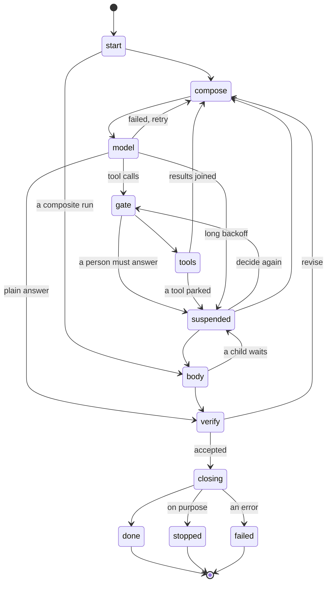

# The state machine

A run is an append-only journal of events. `Fold` computes the `Run` from them, a pure `next` picks the step, and a thin shell does the step and records what happened. So the state is never stored: it is what the events add up to, on any process.

This is why `Run` can be one call. Starting, resuming, signalling and cancelling all load the journal, fold it and carry on from there.

| State | What happens | Plugin points |
|---|---|---|
| `start` | nothing yet: `run.started` records identity, the pin and the input | `Redact` on everything from here on |
| `compose` | the turn limit, then the history, then the request, then the intent to call | `Context`, `BeforeModel` |
| `model` | the paid call: the intent is recorded first, the reply after | `WrapModel`, `AfterModel`, `Recover` |
| `gate` | each call is decided, and the decisions are recorded together | `BeforeTool` |
| `tools` | intents recorded as a group, the tools run, results recorded as they arrive | `WrapTool`, `AfterTool` |
| `body` | a composite run's children advance | a composite's own `Body` |
| `verify` | the candidate answer is judged | `CheckOutput` |
| `suspended` | nothing runs: the run waits for a signal, or a timer | none |
| `closing` | the outcome is decided, and children of a cancelled run are ended | `AfterRun` |
| `done`, `stopped`, `failed` | terminal | none |

`BeforeRun` runs each time a worker takes the run, at the start and on every resume.

## Every step is recorded before anything acts on it

`record` is the one way anything happens. In this order, always: redact, check the edge, append, adopt, emit. An event whose edge is not in the table below fails the run, so an illegal step can't pass silently.

A crash can land between any two events, and each case has one answer, because the journal says how far the run got:

| Last event | What it means | What the next worker does |
|---|---|---|
| `model.started` | the call may have been billed, and its reply is gone | records `model.lost`, counts it in `LostCalls` and calls again |
| `tool.started` on `EffectRead` or `EffectIdempotent` | the effect is safe to repeat | records `tool.lost` and runs the call again, with the same idempotency key |
| `tool.started` on `EffectOnce` | nobody can know whether it happened | records `tool.lost` carrying a `WaitUnknownOutcome` wait in `Waits`, so a person answers |
| `tool.done` | the effect happened and the result is safe | carries on |

Spend is a bound, not exact: `ModelCalls <= billed <= ModelCalls + LostCalls`.

Two workers can't both advance a run. A unique index on `(run_id, seq)` is the fence: `run.claimed` takes the next position, so the old worker's next append fails with `ErrFenced`. See [the design](design/durable-core.md) for the whole argument and its limits.

## Transitions

Generated from `harness.Transitions()`. `TestTheDocsMatchTheTable` fails if this drifts. To refresh it, run `UPDATE_DOCS=1 go test -run TestTheDocsMatchTheTable .`

<!-- transitions -->
| From | Event | To |
|---|---|---|
| `start` | `run.started` | `compose`, `body` |
| `compose` | `history.edited` | `compose` |
| `compose` | `model.started` | `model` |
| `model` | `model.done` | `gate`, `verify`, `compose`, `closing` |
| `model` | `model.failed` | `compose`, `suspended`, `closing` |
| `model` | `model.lost` | `compose` |
| `gate` | `tool.gated` | `gate`, `tools`, `suspended`, `compose`, `closing` |
| `tools` | `tool.started` | `tools` |
| `tools` | `tool.done` | `tools`, `compose`, `suspended`, `closing` |
| `tools` | `tool.lost` | `tools`, `gate`, `compose`, `suspended` |
| `body` | `body.done` | `verify`, `suspended`, `closing` |
| `suspended` | `wait.resolved` | `suspended`, `gate`, `compose`, `body` |
| `verify` | `output.checked` | `compose`, `closing` |
| `closing` | `run.ended` | `done`, `stopped`, `failed` |
<!-- /transitions -->

Every live state also takes `run.claimed`, because any worker may take the run, and `run.stopping`, because a cancel or a hook can end it from anywhere.
