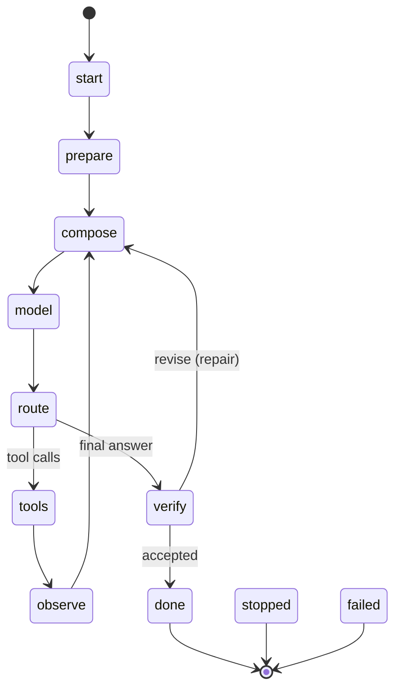

# The state machine

`Agent.Run` executes one **episode**, the outer loop, as a walk over an explicit state graph. Inside it, the **inner loop** repeats one model/tool turn until the model answers without asking for tools, or something stops the run.



Every non-terminal state may also move to `stopped` (on purpose) or `failed` (an error).

## Transitions are data

```go
harness.Transitions() // map[State][]State: the only legal edges
harness.CanTransition(from, to)
s.Loop()              // "outer", "inner" or "terminal"
s.Terminal()
```

The machine checks every edge before taking it. A step function that returns an edge not in the table fails the run with `ErrIllegalTransition`. Bugs show up immediately and can't turn into silent loops. `Result.Path` holds the visited states in order, which makes test assertions trivial:

```go
// tool call, then answer
[start prepare compose model route tools observe compose model route verify done]
```

`state_test.go` checks the table itself. `run_test.go` drives 15 scenarios through table tests and asserts their paths: plain answer, tool turn, tool denied, tool halt, input guardrail, budget, revise, capped repairs, output block, rewrite, max turns, AfterTurn loop stop, handoff, tool error and provider failure. Cancellation is tested separately.

## States

| State | Loop | Does | Leaves to |
|---|---|---|---|
| `start` | outer | creates the `Run`, emits `run.start` | `prepare` |
| `prepare` | outer | `BeforeRun` hooks: admission (guardrails, budget, root span) | `compose`, `stopped`, `failed` |
| `compose` | inner | checks `MaxTurns` (→ `stopped`/`max_turns`), increments `Turn`, builds the `model.Request`, `BeforeModel` hooks | `model` |
| `model` | inner | calls the provider through the `WrapModel` chain; `OnDelta` per streamed event; `AfterModel` hooks; records usage and the assistant message | `route` |
| `route` | inner | tool calls → `tools`, else → `verify` | `tools`, `verify` |
| `tools` | inner | for each call: `BeforeTool` (allow / deny / halt), the `WrapTool` chain, the registry, `AfterTool`. A `*tool.Handoff` result stops the run with `handoff` | `observe`, `stopped` |
| `observe` | inner | `AfterTurn` hooks at the turn boundary | `compose` |
| `verify` | outer | `CheckOutput` hooks: accept, rewrite, revise (append feedback and go back to `compose`, capped by `MaxRepairs`) or block | `done`, `compose`, `stopped` |
| `done`, `stopped`, `failed` | terminal | `AfterRun` hooks, `run.end` event | — |

### Request building

The agent's `Instructions` are added as the system message **at request time** and are never stored in `Run.Messages`. History stays model-agnostic, and a profile or a compactor can't accidentally duplicate the system prompt. `BeforeModel` hooks receive a mutable `*model.Request` and may rewrite it, for example by dropping tools, appending instructions or replacing history.

### Stopping on purpose vs failing

A hook returns `harness.Stop(reason, detail)` to end the run deliberately. The run then ends in `stopped` with `Result.Stop = reason`, and `Run` returns `err == nil`. Any other error ends in `failed` with `StopFailed`, and `Run` returns that error. Callers branch on `res.Stop` and only treat `err != nil` as a bug or outage.

| Reason | Typical source |
|---|---|
| `completed` | `verify` accepted |
| `max_turns` | `compose`, `Agent.MaxTurns` (default 8) |
| `max_repairs` | `verify`, `Agent.MaxRepairs` (default 2) |
| `budget_exhausted` | `hooks/budget` |
| `guardrail` | `hooks/guard`, `Verdict` block |
| `policy` | `hooks/approval` with `HaltOnDeny`, `Decision` halt |
| `loop_detected` | `hooks/budget` repeat detection, `multi.Handoff` hop cap |
| `handoff` | a tool returned `*tool.Handoff` |
| `cancelled` | context cancelled |
| `failed` | provider or tool infrastructure error, illegal transition |

## Events

Each step emits `harness.Event`s to the sinks registered with `harness.WithEvents(ctx, sink)`:

| Kind | When |
|---|---|
| `run.start` / `run.end` | episode boundaries (`run.end` carries stop, usage, turns) |
| `transition` | every edge (`From`, `To`, `Data.loop`) |
| `hook` | every hook invocation (`Hook`, `Point`, `Outcome`, `Duration`, `Text` = the hook's note) |
| `delta` | streamed text |
| `model` | a complete reply (usage, finish, tool-call count) |
| `tool` | a completed tool call (args, outcome, clipped result) |
| `pattern` | a multi-agent pattern step (start, fan-out, verdict, plan, claim, …, end) |

Sub-agents inherit the sinks. Their events carry `Depth > 0` and `ParentRun`, so one sink sees a whole tree of runs. That's how the web chat renders nested patterns live.

## Why these states (and not others)

The states are the moments the video says a harness needs to own:

- before the agent runs → `prepare`
- before each model call, where summarisation and context assembly happen → `compose`
- around the model call → `model`
- around each tool call, where offloading and approval happen → `tools`
- after the agent → the terminal states

`route`, `observe` and `verify` come from ecociel/agents (`production-agent-components.md`, *Explicit state machine*), from tessmir's `agentloop` (turn boundary, verification before acceptance), and from corporate-admin's `agent.Next` steps, which map one-to-one; see [corporate-admin.md](corporate-admin.md). `verify` turns "the model stopped calling tools" into "the answer passed its checks". The repair edge back to `compose` is the single-agent form of the evaluator–optimizer pattern.
